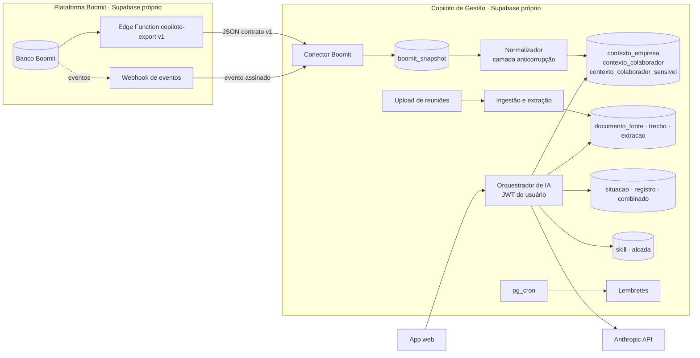

# 02 · Arquitetura e integração com a Plataforma Boomit

**Status:** v0.2 (03/11/2026). A Sprint 0A confirma a stack e o modelo real da Boomit quando o acesso ao repositório sair (o contexto disponível hoje foi levantado pela interface do portal do cliente e tem itens inferidos).

---

## 1. Visão geral

## 2. Decisões de arquitetura

| # | Decisão | Recomendação | Motivo | Alternativa considerada |
|---|---|---|---|---|
| D1 | Onde ficam os dados | **Projeto Supabase separado** | Mentorias e feedbacks têm outra finalidade e sensibilidade; release independente; o Copiloto pode atender outros clientes Boomit; uma falha não derruba o outro sistema | Schema `copiloto` dentro do projeto Boomit: começa mais rápido, mas mistura políticas e acopla deploys |
| D2 | Stack | **Espelhar a Boomit** (hipótese: React + Vite + Supabase Edge Functions) | Mesma equipe, mesmos padrões; o Claude Code reaproveita convenções do repositório Boomit | Next.js — só se o repositório Boomit já usar |
| D3 | Integração | **API decidida (03/11)**: pull do contrato versionado + eventos opcionais. Em desenvolvimento, **modo mock** com `fixtures/boomit/` no mesmo contrato. Importação de Excel/PDF só como contingência | Contrato isola os dois sistemas; o mock permite construir tudo antes da API existir | Leitura direta do banco Boomit (ver §3.1, modo B) |
| D4 | Modelo dos dados Boomit no Copiloto | **Snapshot bruto + contexto normalizado em JSONB** | A Boomit ainda muda (textos regeneráveis, chaves não normalizadas); o normalizador absorve a mudança sem migration | Espelhar tabelas Boomit: acopla e quebra a cada mudança |
| D5 | Busca em transcrições | **Busca textual do Postgres em português** na Fase 1 | Volume por líder é pequeno; menos fornecedores recebendo dados | Embeddings (pgvector) se a avaliação de qualidade mostrar necessidade |
| D6 | Chamadas à IA | **Só em Edge Functions, com o JWT do usuário** | A RLS filtra o que entra no prompt; `service_role` fica restrito a conector, ingestão e jobs | — |
| D7 | Reuniões | **Transcrições e anotações na Fase 1**; áudio na 1.5 | Evita escolher provedor de transcrição antes do piloto; o Meet já gera anotações | Upload de áudio com provedor externo |
| D8 | Contas e hospedagem | **Contas da Leadrix primeiro** (GitHub, Supabase, Anthropic, hospedagem), migração depois para as contas da Boomit | Velocidade agora; a Boomit recebe um sistema pronto | Começar direto nas contas Boomit |
| D9 | Motor de IA | **Isolado em `_shared/motor/`**, sem dependência da Boomit | Será extraído para pacote compartilhado com outro produto da Leadrix | Motor acoplado ao produto |

## 3. Integração com a Boomit

### 3.1 Modos de integração

| Modo | Como funciona | Quando usar |
|---|---|---|
| **A · API (decidido)** | Edge Function `copiloto-export` no projeto Boomit. `GET ?empresa_id=…&desde=…&cursor=…`. Autenticação por token por empresa, só leitura, rotacionável. Resposta no contrato `contracts/boomit-export.v1.schema.json`. Eventos opcionais (`assessment.concluido`, `focus.concluido`, `pdi.gerado`, `devolutiva.concluida`, `colaborador.alterado`) via POST assinado (HMAC) para `boomit-evento` no Copiloto, que dispara a releitura daquele colaborador. | Padrão |
| **B · Leitura direta** | Views `copiloto_v1_*` no banco Boomit, acessadas por um papel somente leitura. | Se A atrasar e houver acordo técnico com a Boomit |
| **C · Importação** | Admin sobe o Excel de colaboradores, o Excel do Resumo Estratégico e os PDFs da Análise do Colaborador. Extração para o mesmo contrato, marcada `fonte = importacao_*`, com revisão do admin. | Contingência, se a API atrasar a ponto de travar o piloto |
| **Mock (desenvolvimento)** | `FonteMock` lê `fixtures/boomit/empresa-exemplo.v1.json`, valida contra o contrato e entra na mesma esteira (snapshot → normalizador → contexto). Troca para a API por `BOOMIT_FONTE=api`. | Agora, até a API existir |

Frequência: diária (madrugada), sob demanda pelo admin e por evento.

### 3.2 O que o Copiloto consome (minimização)

| Dado Boomit | Importa? | Uso no Copiloto |
|---|---|---|
| Empresa: nome, setor, maturidade (nota, score, diagnóstico, próxima etapa) | Sim | Contexto organizacional das orientações |
| Pontos-chave, desafios críticos e risco por ponto-chave | Sim | Conectar a conversa ao que importa para o negócio |
| Estratégias prioritárias, alinhamento médio, maturidade de IA da empresa | Sim | Contexto |
| Financeiro da empresa (faturamento, custo, lucro, perda em R$) | **Não** (Fase 2) | — |
| Colaborador: id, e-mail, nome, cargo, área, nível, diretoria, status da jornada | Sim | Identidade, filtros, linha do tempo |
| Salário, gênero, celular | **Não** | Sem finalidade na Fase 1 |
| Digital de Crescimento (10) e Táticas (9): auto, meta, atual | Sim | Gaps e autopercepção |
| Relatório Focus (análises técnica e comportamental, mentor) | Sim | Parecer do mentor como fonte citável |
| Projeto Performance (PDI Boomit): textos, pontos-chave, KPI | Sim | Base das conversas de PDI |
| Alinhamento de propósito, indicador de potencial, perfil hierárquico | Sim | Contexto |
| 16 Personalidades | Sim | Referência para preparar a abordagem, nunca rótulo |
| Maturidade em IA individual (N1–N5 e 5 dimensões) | Sim | Desenvolvimento e descoberta de talentos |
| Devolutiva, sessões Focus (datas e status) | Sim | Linha do tempo |
| PPL individual, performance técnica, quadrante da matriz, ação R3 | Sim, em **tabela separada** | Exibição só se `exibir_indicadores_sensiveis = true` (regra no banco) |
| Textos de IA organizacionais (autopercepção, insights IA 360) | Sim, com data | Contexto; nunca fonte de números |

### 3.3 Camada anticorrupção — regras do normalizador

Cada regra vira teste unitário no Sprint 1. Problemas numerados conforme a seção 8 de `referencia-boomit-plataforma-contexto.md`.

| # | Problema na Boomit | Regra no Copiloto |
|---|---|---|
| R1 | Competências com chaves não normalizadas (`Comunicacao_eficaz`, `Comunicacaoefetiva`, `Construção De Planos` duplicada) | Normalizar a chave (minúsculas, sem acento, `_` → espaço, espaços colapsados) e mapear por `competencia_sinonimo`. Chave desconhecida gera alerta, não erro. |
| R2 | Maturidade diferente entre Home e Resumo Estratégico | Fonte oficial: o campo `maturidade` do contrato (Resumo Estratégico). Divergência vira alerta. |
| R3 | Textos de IA citam números que não batem com os campos | Números sempre dos campos estruturados. Texto guarda `gerado_em`; percentual citado no texto que diverge vira alerta. |
| R4 | Temperamentos MBTI agregados errados (Sentinelas = 0) | Recalcular a partir do tipo: NT, NF, SJ, SP. |
| R5 | Vírgula e ponto decimais; datas `dd/mm/aaaa` | Aceitar os dois separadores; converter datas para ISO 8601. |
| R6 | Área fora do enum; cargo livre | Guardar valor bruto e `area_normalizada`. Cargo só para exibição. |
| R7 | Etapa Personalidade 0% com tipo preenchido | Status derivado da presença do tipo. |
| R8 | Escalas de tempo de desenvolvimento diferentes entre telas | Guardar meses; faixa calculada no Copiloto. |
| R9 | Seções com erro de geração (Digital Organizacional) | `secoes_indisponiveis[]`; a sincronização nunca falha inteira. |
| R10 | Textos regeneráveis mudam entre leituras | Snapshot imutável deduplicado por hash; diferença gera nova versão. |
| R11 | "Colaborador destaque" cai no primeiro da lista em empate | Ignorar campos de destaque; o Copiloto calcula quando precisar. |

### 3.4 Identidade e correspondência

Chave principal `boomit_colaborador_id`; reserva pelo e-mail (não editável na Boomit). Colaborador desativado na Boomit fica `ativo = false` no Copiloto, com histórico preservado.

### 3.5 O que a Boomit não tem e o Copiloto precisa ter

| Lacuna | Solução |
|---|---|
| Quem lidera quem | `vinculo_lideranca`, importado de planilha do RH ou editado no admin |
| Transcrições das mentorias regulares | Upload no Copiloto pelo mentor |
| Alçadas por nível ou cargo | Tabela `alcada`, configurada pela empresa |
| Registro do dia a dia e combinados | Núcleo do Copiloto |

## 4. Ingestão de reuniões e mentorias

1. Upload para bucket privado (`{empresa_id}/{documento_id}/…`), status `recebido`.
2. Extração de texto conforme o formato (.docx, .pdf, .vtt, .txt, .md).
3. Detecção do tipo: **anotações do Gemini** (resumo com "Próximas etapas" e responsáveis entre colchetes) ou **transcrição completa** (com locutores).
4. Divisão em trechos (por locutor e tempo, ou blocos de ~1.500 caracteres) com busca textual em português.
5. Sugestão de pessoas vinculadas (nomes encontrados × equipe do líder) — o usuário confirma.
6. Extração (modelo rápido) de combinados, decisões e temas, cada um apontando o trecho de origem → `extracao` pendente.
7. Líder revisa; o que aprova vira `combinado` aberto com lembrete.
8. Se houver preparação da mesma situação: comparação **planejado × combinado** (como planejado · alterado · não tratado).

Processamento assíncrono com fila (pgmq ou tabela de jobs) — documentos longos não podem depender do tempo de uma requisição.

## 5. Segurança e LGPD

| Tema | Regra |
|---|---|
| Isolamento | `empresa_id` em todas as tabelas, RLS em todas, testes por perfil |
| Privacidade do líder | Ensaios (situação, preparação, simulação) só do autor e do mentor com quem ele compartilhar; auditoria desses itens guarda só metadados |
| Indicadores sensíveis | Tabela separada com política condicionada à configuração da empresa |
| Treinamento de modelos | Nenhum; contexto enviado por chamada |
| Logs de IA | Metadados (modelo, tokens, custo, fontes); sem conteúdo |
| Arquivos | Buckets privados, URLs assinadas curtas |
| Retenção | Configurável por empresa (`retencao_dias`), a definir com os jurídicos |
| Revisão humana | Nada vira registro corporativo sem confirmação do líder |
| Hospedagem na Leadrix | Só dados fictícios até existir contrato de tratamento de dados com Boomit e EasyJur |
| Papéis de tratamento | Definir controladora, operadoras e contratos entre EasyJur, Boomit, Leadrix (se operar a solução) e fornecedores antes do piloto |

## 6. Preparação para a migração Leadrix → Boomit

| Item | Regra desde o primeiro commit |
|---|---|
| Banco | Só migrations e seeds versionados; nada de alteração manual de schema |
| Configuração | `supabase/config.toml` versionado; provedores de login e redirects por ambiente |
| Storage | Buckets e políticas criados por migration |
| Segredos | Somente variáveis de ambiente; `.env.example` completo |
| Funções | Edge Functions implantadas por CLI/CI, nunca editadas no painel |
| Dados | Enquanto só houver dados fictícios, migrar = recriar o ambiente. Com dados reais, o runbook cobre banco, storage e usuários |
| Registro | `docs/runbook-migracao.md` atualizado a cada configuração fora do código |
